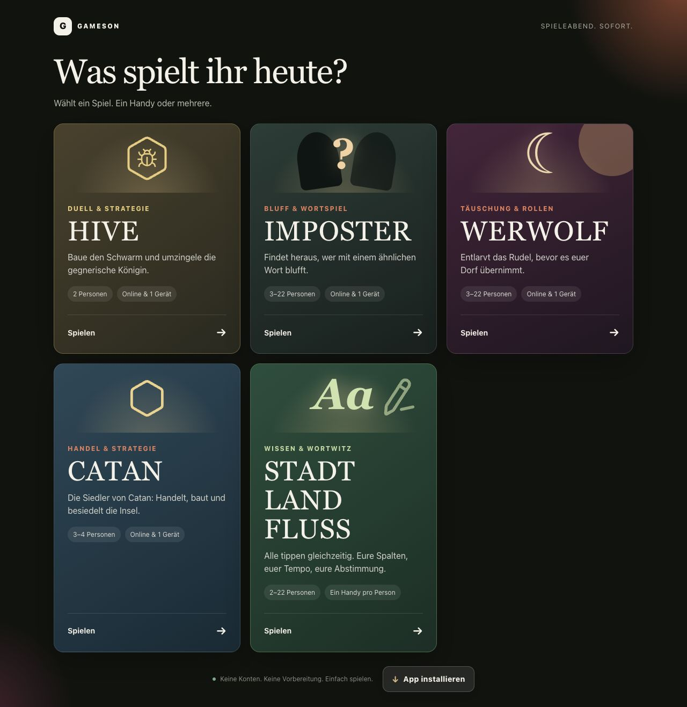
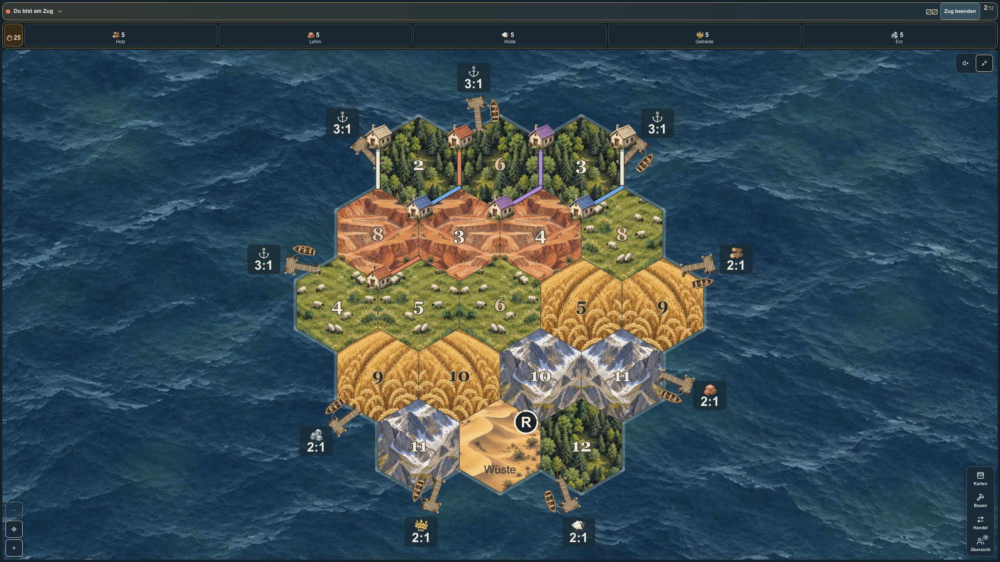

# Gameson

**Spieleabend. Sofort.** Six German games for your next games night, played on
separate phones or one shared device. No accounts are required. Gameson is an
installable web app with online lobbies, private player views and local play.

[Games](#games) · [Run locally](#run-locally) · [Development](#development) · [Hosting](#ubuntu-hosting-with-https) · [Artwork](assets/catan/README.md)



## Games

| Game | Players | Modes | Route |
| --- | --- | --- | --- |
| **CORE BALL** | 2–8 | Cooperative or competitive, online or one shared device | `/core-ball` |
| **HIVE** | 2 | Online or one shared device | `/hive` |
| **Imposter** | 3–22 | Online or one shared device | `/imposter` |
| **Werwolf** | 3–22 | Online or one shared device | `/werwolf` |
| **Die Siedler von Catan** | 3–4 | Online or one shared device | `/catan` |
| **Stadt Land Fluss** | 2–22 | One device per player, online | `/stadt-land-fluss` |

Online players join through invitation links, QR codes, lobby codes or group
names. Discoverable waiting lobbies appear to other devices on the same network;
hosts can turn discovery off. The home screen offers installation as a PWA.
Local games work offline after their pages and assets have been loaded online;
Catan, HIVE and Core Ball also save local progress after every move. Keep local Imposter
and Werwolf games open: reloading resets the current match. Online games require
a connection to the server.

### CORE BALL

Tap to attach a ball to a rotating circle without touching an existing ball.
Everyone shares the circle; only the active player can shoot. Completing a
level or colliding passes play to the next seat. After a successful shot, the
active player can hand off to anyone else. Rotation pauses at every handoff
until the new player presses **Bereit**.

Cooperative groups try to finish as many levels as possible. In competitive
play, each successful shot earns a provisional point; a completed level banks
those points, while a collision discards the level's contributions and restarts
the same level. The host ends an online match explicitly; on a shared device,
the group can end it. Unfinished points are discarded and tied leaders share
the victory. There is no timer or final level.

The deterministic rotation adds speed modulation and direction changes as
levels progress, with at most eight initial balls and sixteen new balls.
Shots land after 150 ms. Server-authoritative online actions use synchronized
tap timestamps, revision guards and idempotent command receipts. Authenticated
WebSockets push changes; reconnecting clients reconcile through HTTP. The host
can explicitly skip an absent player without losing balls or contributions.
Reloading a local match restores it paused; online reloads restore the current
server state.

### Catan in play



The island uses hand-painted terrain and building atlases. One sharp sea image
is continuously distorted on the GPU, with camera parallax while panning and
zooming. Reduced motion keeps a still background. The screenshot shows a sample
position using the real game components; the artwork and original generation
prompts are documented in [Catan artwork](assets/catan/README.md).

### HIVE

The 22-piece base game includes queens, beetles, grasshoppers, spiders and ants.
The rules engine enforces the fourth-turn queen deadline, one connected hive,
sliding gates, stack control, exact spider paths and straight grasshopper jumps.
Legal targets and a move preview appear before confirmation. Tapping a beetle
stack reveals its layers; selecting a blocked piece explains the relevant rule.

Pan, zoom or fit the board; resign, offer a draw or start a rematch with swapped
colors. Local players can undo a turn by mutual agreement. The six-exercise
[tutorial](app/hive/page.tsx) at `/hive?tutorial=1` uses separate practice
positions and preserves the saved game. Rules reference: [Gen42 HIVE](https://www.gen42.com/product/hive/).

### Imposter

Players receive related but different secret words, give clues and vote for the
suspected imposters. Choose a themed word pool, family or adult content, or add
custom word pairs. The number of imposters is configurable. On a shared device,
private cards stay hidden between players; online, each person receives their
own assignment.

The built-in word pool in `lib/game.ts` contains 1,020 curated pairs: 120 in
each of the six family categories and 100 in each of the three adult categories.
Pairs connect different subjects through shared situations, functions or sensory
properties. Imposter words allow several plausible guesses; close variants and
shared word stems are avoided. Categories follow the crew word, and adult crew
words include explicit sexual vocabulary. Family mode excludes all adult pairs.
Adult mode with the random pool mixes both ratings; choose an adult category
for an exclusively 18+ round.

### Werwolf

The app guides the group through private role reveals, night actions,
discussion, mayor elections and village votes. Wolf counts and additional roles
are configurable. Available roles include the seer, witch, hunter, cupid, thief,
healer, piper, wild child, elder, scapegoat and white werewolf.

Recorded announcements accompany the phases, with configurable audio modes and
pauses between announcements. Active recordings live in
[public/audio/werwolf](public/audio/werwolf/); unused source recordings are
explained in the [audio archive](assets/audio/werwolf-unused/README.md).

### Die Siedler von Catan

The base game freely randomizes terrain, number tokens and coastal harbor
positions with cryptographic randomness. The usual 19-hex shape and terrain,
number and harbor inventories stay fixed; larger resource clusters and adjacent
6/8 tokens are allowed. All nonoverlapping harbor placements have the same
chance. Every rejected map is drawn independently, without balancing filters,
templates or forced differences from the previous map.

The base game includes snake-order setup, resource production, limited bank and
pieces, player and harbor trading, the robber, discards, stealing, all 25
development cards and both special awards. The victory target is selectable
from 8 to 15, default 12; choose 10 for the original target.

Every new online or local match starts with a map vote. Each player accepts or
rejects the terrain, numbers and harbors; the result is evaluated after everyone
has voted. A majority accepts the map, while rejection immediately generates a
new map and clears the ballots. On a 2–2 tie the lobby host explicitly chooses
whether to accept or generate another map. On a shared device, players vote in
name-entry order and the first entered player decides ties. Votes are visible,
final and saved across reloads; there is no timeout or reroll limit. Setup starts
only once the map is accepted. Existing saved matches continue where they were.

Online hands and deck order stay on the server. Atomic revisions validate
updates; authenticated WebSockets deliver confirmed moves to connected players.
The client reconciles every minute and falls back to 2.5-second HTTP polling
while reconnecting. Repeated revisions do not replay construction effects.
Local games hide private hands when passing the device.

The five areas—Island, Cards, Build, Trade and Overview—keep the current action
and resource hand available. The map supports drag, pinch zoom, centering and
fullscreen. Select building and robber positions directly on the island.
Construction and trades require explicit confirmation. Normal phase
changes preserve the chosen area and unfinished inputs; new required tasks or
incoming offers open the relevant area.

<details>
<summary>More Catan interface details</summary>

- Fullscreen keeps status and resources above the map and provides Cards, Build,
  Trade and Overview in a right-hand menu, with hover previews and pinned menus.
- A three-step setup guide explains placement and production probabilities. It
  can be skipped or reopened during setup.
- Development cards are grouped by type and availability; an older playable
  copy is preferred. Required discards replace the card list with quantity rows.
- Bank trades preview both resources, the harbor rate and affected stocks.
  Player offers use four steps; incoming offers expose accept, decline and
  counteroffer actions.
- Resource gains and payments appear in a private activity history. Trade
  changes are grouped, and unread receipts remain available on the next visit.
- Confirmed roads unroll over 700 ms; settlements and city upgrades rise over
  750 ms. Hidden views, restored games and reduced motion show finished pieces.
  Local setup roads allow an 800 ms transition before the next handoff.
- The sea pauses when the island or document is hidden. Its wave cycle lasts
  4.5 seconds; movement strength and camera parallax are separate settings.
- Optional island atmosphere adds drifting clouds and land shadows, coastal
  surf, occasional sailing boats and larger pirate ships with wakes, gull flocks,
  offshore fog and desert dust. Connected woods and grain fields sway in successive gusts;
  broad sea reflections drift over 45 seconds. Cloud sizes stay legible in the
  overview and bounded while zooming. The existing atmosphere switch controls
  these effects, and reduced motion stops them. Camera gestures freeze their
  movement without resetting cloud or fog positions.
- Optional resource sounds play for gains or field inspection. They start
  disabled and work offline. The wood sound uses the complete user-provided
  `Wood Planks Falling Sound - Sound Effects_.ogg`, converted to
  [MP3](public/audio/catan/v1/resource-wood-planks-gain.mp3).

</details>

### Stadt Land Fluss

Players write simultaneously in 2–12 custom columns, across 1–20 rounds with
an optional 15–1800 second timer. Defaults are Stadt, Land, Fluss, Tier and Beruf,
five rounds and 120 seconds. The host can change columns between rounds and
change or disable the timer during a round.

Answers autosave with per-player sequences; only the player's own answers are
returned during writing. The server enforces deadlines, and reloading restores
saved answers plus newer local drafts. Answers must reach the server before the
deadline; outstanding saves are shown in the UI.

During review, players can dispute answers and change their votes. A majority
of cast votes decides; ties accept an answer. Empty or wrong-initial answers
score 0, accepted duplicates 5, unique answers 10, and the only accepted answer
in a column 20. Each round uses a fresh letter, and the scoreboard retains all
rounds.

## Run locally

Requirements: **Node.js ≥22.13.0**, npm and Git. The app uses React, TypeScript
and vinext/Vite with a Cloudflare Worker runtime and the `DB` D1 binding. Local
Worker data is stored under `.wrangler/state/`, which is ignored by Git.

From a checkout, install dependencies, build the Worker configuration and
initialize Catan's table once before starting development:

```bash
npm ci
npm run build
npx wrangler d1 execute DB --local --persist-to .wrangler/state --config dist/server/wrangler.json --file drizzle/0007_catan.sql
npm run dev
```

Open [localhost:3000](http://localhost:3000). For a different development port:

```bash
npm run dev -- -p 3001
```

The Catan table migration is safe to repeat. Other game tables and supported
additive columns are created by the [runtime schema bootstrap](db/index.ts).
Catan's discovery columns are also added there; do not replay its later
`ALTER TABLE` migration after those columns already exist.

To preview the built Worker locally, stop the development server and run:

```bash
npx wrangler dev --config dist/server/wrangler.json --local --persist-to .wrangler/state --ip 127.0.0.1 --port 3000
```

## Development

| Command | Purpose |
| --- | --- |
| `npm run dev` | Development server with the local Worker/D1 runtime |
| `npm run build` | Production client and Worker build in `dist/` |
| `npm test` | Production build followed by automated tests |
| `npm run lint` | Source checks |
| `npm run test:catan:demo` | Visible, slow Playwright Catan match with real random map and audio |
| `npm run test:catan:demo:1` | One visible player view; the other two players run headless |
| `npm run test:catan:demo:3` | All three player views visible (same as the default demo) |
| `npm run db:generate` | Generate Drizzle migration SQL; does not apply it |

The tests cover game rules, APIs, sessions, UI rendering, map controls, realtime
updates and Ubuntu setup behavior.

For deterministic atmosphere previews, run
`CATAN_QA_FIXTURE=catan-atmosphere.tsx node tests/catan-ux-preview.mjs`, then
`node tests/catan-atmosphere-browser.mjs` in another terminal. This checks normal
motion at zoom 1, 3 and 6 on four screen sizes, fullscreen, scenery click-through,
motion preferences and independent artwork failures. Screenshots are written to
the ignored `.wrangler/catan-atmosphere/` directory.

### Core Ball browser check

With the development server running on port 3000 and Playwright's Chromium
available, run `node tests/core-ball-browser.mjs`. The check uses five isolated
phone-sized browser sessions and a separate shared-device game. It exercises
real UI handoffs, readiness, reloads, results, clock skew, added network latency
and HTTP fallback when WebSockets are unavailable. Screenshots are saved under
`.wrangler/core-ball-browser/`. `CORE_BALL_BROWSER_URL` selects another local
development URL.

### Live Catan browser demo

After the local database setup above, install Playwright's Chromium once and
start the demo:

```bash
npx playwright install chromium
npm run test:catan:demo
```

Playwright opens three visible browser views with independent players (Anna, Ben
and Clara) in a fresh lobby on the local server. To show only one player view
while the other two players keep playing through the real UI headlessly, run:

```bash
npm run test:catan:demo:1
```

`npm run test:catan:demo:3` explicitly selects all three visible views, matching
the default command. You can also set `CATAN_DEMO_VISIBLE_BROWSERS=1`, `2` or `3`
with `npm run test:catan:demo`. The selected `CATAN_DEMO_VIEWER` is always visible;
only that player's audio is enabled, including in the one-view demo.
`CATAN_DEMO_HEADLESS=1` still makes all players headless regardless of this count.

The demo starts the match through the real UI, so terrain, numbers, harbors,
starting player, dice and cards use the
normal random generator. No prepared board, fixed seed, injected resources or
scripted dice are used. The bots vote for the map, complete snake-order setup
and play legal moves until someone reaches **8 points**. They use bank trades
and development cards; player-to-player offers are not part of the demo.

Anna's reference view stays in the foreground with a small step label; Ben and
Clara take their turns in their own sessions. Real sound effects are enabled for
Anna, other players are muted, and each action waits for
the dice animation and all scheduled audio to finish before the next action.
There is also a 1.5-second reading pause and a slower browser action speed.
The final view stays open for 15 seconds. The demo starts a development server
automatically if port 3000 is free, or reuses the running local server.

For just one complete round after setup (three player turns), or longer pauses:

```bash
CATAN_DEMO_ROUNDS=1 npm run test:catan:demo
CATAN_DEMO_STEP_MS=4000 CATAN_DEMO_TARGET=10 npm run test:catan:demo
```

Other options: `CATAN_DEMO_VIEWER=Ben` (or `Clara`) selects another fixed player
perspective. `CATAN_DEMO_SLOW_MO_MS` changes browser action speed (default
250), `CATAN_DEMO_HOLD_MS` changes the final viewing time, and
`CATAN_DEMO_MAX_TURNS` bounds a full match (default 300; hitting it fails the
test). `CATAN_DEMO_URL` selects an already-running development instance; the
demo creates a real lobby there. Use a development instance for demos.

For quick automated verification, explicitly opt into headless execution and
skip the intentional audio wait:

```bash
CATAN_DEMO_HEADLESS=1 CATAN_DEMO_STEP_MS=0 CATAN_DEMO_SLOW_MO_MS=0 CATAN_DEMO_HOLD_MS=0 CATAN_DEMO_WAIT_FOR_AUDIO=0 npm run test:catan:demo
```

The normal demo checks successful moves, unchanged terrain after map acceptance,
the victory condition, decoded/played audio, and uninterrupted sounds. Screenshots,
the generated map and playback counters are saved under
`.wrangler/playwright-results/`; failed runs include a Playwright trace. It uses
isolated browser sessions and leaves your saved local games intact. This manual
demo is separate from `npm test`.

### Catan UI preview

Build once, then start the local component preview:

```bash
npm run build
node tests/catan-ux-preview.mjs
```

Open [localhost:3002](http://localhost:3002). Prepared states cover setup,
trading, discards, card play, long histories and game over. For confirmed own
and remote construction animations, use:

```bash
CATAN_QA_FIXTURE=catan-construction.tsx node tests/catan-ux-preview.mjs
```

`CATAN_QA_PORT` overrides the preview port. Run one component preview at a time
and reload after component changes. The preview is a development tool and is
not an application route or part of the deployed UI.

### Repository map

| Path | Contents |
| --- | --- |
| [app/](app/) | Game pages, layouts, styles and API routes |
| [components/](components/) | Shared UI and game boards |
| [lib/](lib/) | Rules engines, sessions, audio and realtime helpers |
| [db/](db/) and [drizzle/](drizzle/) | D1 schema, runtime bootstrap and migrations |
| [worker/](worker/) | Worker entry point and live Durable Objects |
| [public/](public/) | PWA assets, active artwork and audio |
| [assets/](assets/) | Asset documentation and archived source material |
| [tests/](tests/) | Automated tests and browser preview fixtures |
| [scripts/setup-ubuntu.sh](scripts/setup-ubuntu.sh) | Ubuntu installer and updater |

The [Vite configuration](vite.config.ts) defines the local Worker bindings.
Catan push updates require the `CATAN_LIVE` Durable Object binding, exported
`CatanLobbyLive` class and `catan-live-v1` SQLite namespace migration. Keep those
entries in the generated Worker configuration. The Sites build also includes
hosting metadata and Drizzle migrations in `dist/.openai/`.

Core Ball uses the separate `CORE_BALL_LIVE` binding, `CoreBallLobbyLive` class
and `core-ball-live-v1` SQLite namespace migration. Its D1 table is initialized
at runtime; [0011_core_ball.sql](drizzle/0011_core_ball.sql) also provides an
idempotent migration for managed deployments.

## Ubuntu hosting with HTTPS

The included setup supports Ubuntu 22.04 and 24.04. Install Git first, point the
domain's `A`/`AAAA` records to the server and allow inbound TCP ports 80 and 443.
The repository path must not contain spaces. The script installs the required
Node.js runtime, Nginx, systemd and Certbot; the persistent local Worker/D1
runtime listens on `127.0.0.1:3000` behind Nginx.

```bash
sudo install -d -o "$USER" -g "$(id -gn)" /opt/gameson
git clone https://github.com/MrRedsnow/gameson.git /opt/gameson
cd /opt/gameson
sudo ./scripts/setup-ubuntu.sh games.example.com admin@example.com
```

Rerun the same command to update. The installer fetches the current branch from
`origin`, allows only fast-forward updates and refuses changes to tracked files.
It installs dependencies and rebuilds when required. The service restarts when
the build or service configuration changes; a required build briefly stops the
running service. Valid Let's Encrypt certificates are reused and renewed within
the configured renewal window.

Data is kept outside the checkout in `/var/lib/gameson`, including D1 and
Durable Object state. Rebuilds preserve that directory.

```bash
systemctl status gameson
journalctl -u gameson -f
sudo systemctl restart gameson
sudo certbot renew --dry-run
```

When updating an installation with an older setup script, run
`git pull --ff-only` once before invoking it. Subsequent runs update the checkout
themselves. To deploy the current checkout without fetching, or force a rebuild:

```bash
sudo env GAMESON_UPDATE_REPO=0 ./scripts/setup-ubuntu.sh games.example.com admin@example.com
sudo env GAMESON_FORCE_REBUILD=1 ./scripts/setup-ubuntu.sh games.example.com admin@example.com
```

See the script's `--help` output for port, data-directory, branch and certificate
renewal options.

### Database backup

Stop the service before copying the entire data directory so SQLite/WAL files
and Durable Object state form a consistent backup:

```bash
sudo systemctl stop gameson
sudo tar -C /var/lib -czf "/root/gameson-backup-$(date +%F).tar.gz" gameson
sudo systemctl start gameson
```
